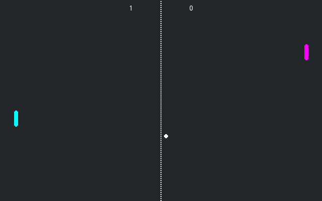
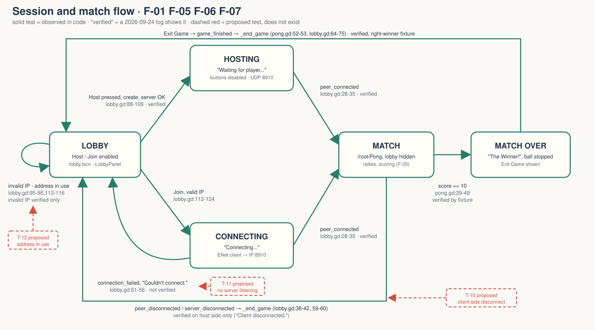
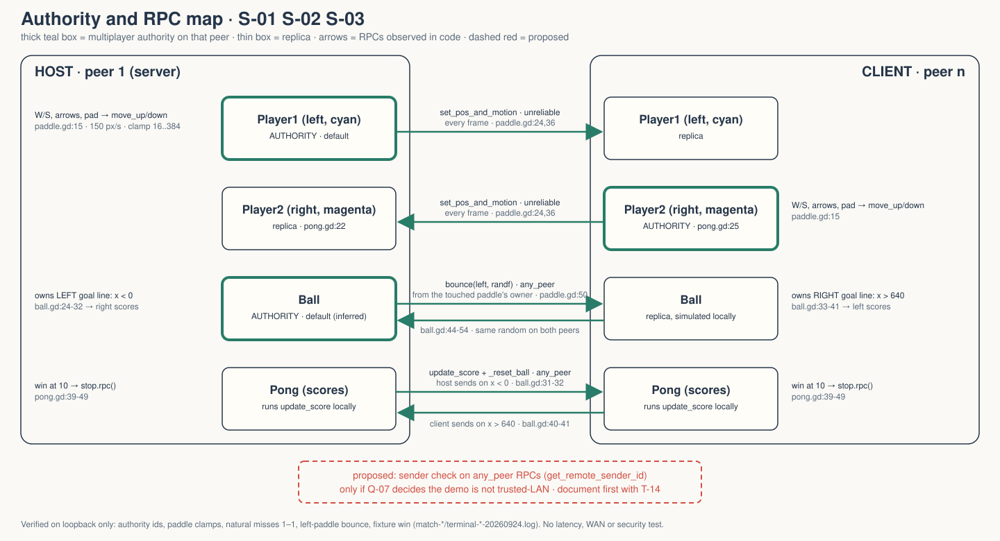

# walker-networking-multiplayer-pong — Game Design Document (recovered)

| | |
|---|---|
| Version | 0.1.0-recovered |
| Date | 2026-09-27 |
| Author | Zelda (agent, silent) for Nik Bear Brown |
| Mode | recovered, silent |
| Revision | 1 |
| Gates | vision ○ · systems ○ · world ○ · scope ○ (none signed) |
| Source | `godot/` (Walker copy of Godot `networking/multiplayer_pong`, source commit `a3b5c113112f77291d5f3d1360f33a882fdc52f7` per `README.md:3-4`) |

gate — unsigned at time of writing

Provenance tags: `[OBSERVED path:line]` the code or a file on disk says this · `[INFERRED]` the evidence strongly implies this; the evidence is stated · `[MISSING Q-xx]` nothing on disk can tell you this; logged as an open question in `decisions.md`. Paths are relative to the project folder (`walker-networking-multiplayer-pong/`). Three levels of truth are kept apart: **source observation** (the code says it), **implemented** (a scene wires the code in), **verified** (a `*-20260924.log` or `FRICTIONAL.md` shows it ran and passed). Nothing in this document is approved design.

*`[OBSERVED godot/screenshots/pong_multiplayer.png]` 640×400 upstream screenshot shipped with the demo (`godot/README.md:17-19`): cyan left paddle, magenta right paddle, dotted separator, ball, score 1–0. This is the upstream's image, not a Walker capture. Walker's own capture and both films are pending under a shared capture blocker `[OBSERVED README.md:11; FRICTIONAL.md:21-22]`.*

## 1. Vision summary

**What this is.** A tech demo, not a game design. It is the official Godot networking sample for two-peer Pong over ENet, copied into Walker with two small adaptations. `[OBSERVED godot/project.godot:17 tags "2d", "demo", "network", "official"; README.md:3-10]`

**What it demonstrates.** How to split multiplayer authority between a host and one client so that each peer owns its own paddle and its own goal line, with a ball that is simulated locally on both peers and only re-synchronised at bounces and resets. `[OBSERVED godot/logic/pong.gd:16-25; godot/logic/ball.gd:13-41]`

**Walker adaptations.** Window title "Walker — Multiplayer Pong" `[OBSERVED godot/project.godot:13]` and an opt-in `--walker-loopback` user argument that binds the host to 127.0.0.1 `[OBSERVED godot/logic/lobby.gd:92-93]`. Everything else is upstream default `[OBSERVED README.md:8-10]`.

**Logline, player fantasy, target player.** None exist on disk. The upstream description is operational ("One of the players should press Host…") `[OBSERVED godot/project.godot:14-16]`, not a vision. Why Walker keeps this demo, and who it is for, is `[MISSING Q-01]` and `[MISSING Q-02]`.

**Ghost Center, as expected.** The code has a clear technical center (authority split) and no design center. `[INFERRED]` from the structure: the vision was "show the smallest complete networked game where authority is visible", because every non-trivial line of the four scripts is about who owns what; there is no content, progression, or presentation layer beyond labels.

## 2. Design pillars

No pillars are recorded anywhere in the folder `[MISSING Q-03]`.

Candidate pillars the code behaves as if it serves, offered only as evidence for Q-03, not as design `[INFERRED]`:

| Candidate | Evidence |
|---|---|
| Each peer is authoritative over its own side | paddle authority `godot/logic/pong.gd:20-25`; goal-line authority comments `godot/logic/ball.gd:24-41` |
| Smooth local motion over strict sync | comment "each player sees the motion as smooth and not jerky" `godot/logic/ball.gd:13-15`; unreliable paddle RPC `godot/logic/paddle.gd:22-24,36` |
| Smallest complete match | one scene, fixed win at 10, exit back to lobby `godot/logic/pong.gd:5,39-53` |

## 3. Core loop

**Session loop** `[OBSERVED godot/logic/lobby.gd]`: Lobby → Host (server waits, both buttons disabled, `lobby.gd:88-109`) or Join (valid IP required, `lobby.gd:112-124`) → `peer_connected` instantiates `pong.tscn` and hides the lobby (`lobby.gd:28-35`) → match → win screen with Exit Game (`pong.gd:47-49`) → `game_finished` → `_end_game` frees Pong, drops the peer, re-enables the lobby (`lobby.gd:64-75`). Disconnects and connection failure short-circuit back to the lobby with a status message (`lobby.gd:38-60`).

**Match loop (micro, seconds)** `[OBSERVED]`: read the ball → move own paddle up/down (`paddle.gd:15`) → ball hits a paddle and bounces faster at a random angle (`ball.gd:45-54`) or crosses a goal line and scores (`ball.gd:30-41`) → ball resets to centre at base speed, heading left or right per the `for_left` argument (`ball.gd:63-69`) → repeat until one side reaches 10 (`pong.gd:40-45`).

**Macro.** None. There is no persistence, save, rematch, or stats code in the project `[OBSERVED: no save/load or scene-transition code beyond lobby.gd:30-35,64-69]`. Whether a macro loop is wanted is part of `[MISSING Q-05]`.

**Loop honesty test.** Strip the networking and this is Pong: a real two-player decision loop (position against a speeding ball), inherited from the genre, not designed here. The networking is the subject; the loop is the vehicle. `[INFERRED from project.godot:17 tags and the non-multiplayer twin linked at godot/README.md:15]`

## 4. Player Experience Goals

None recorded `[MISSING Q-04]`. For a tech demo the "player" may be a developer reading the code rather than someone playing; which audience applies is `[MISSING Q-02]`.

What the code visibly tries to make true, for use when Q-04 is answered `[INFERRED]`:

| ID | Candidate | Evidence | Verified? |
|---|---|---|---|
| PX-01 (candidate) | I know which paddle is mine | "You" label on each paddle, hidden on first own input or immediately on the remote copy `godot/paddle.tscn:19-26; godot/logic/paddle.gd:17-18,25-27` | not verified (no rendered capture) |
| PX-02 (candidate) | My paddle responds without waiting for the network | authority moves locally, then sends position `godot/logic/paddle.gd:14-24,29` | loopback only: both peers saw clamps `match-host-20260924.log:7-8` |
| PX-03 (candidate) | Points are fair even under lag | each peer decides only its own goal line `godot/logic/ball.gd:24-41` | loopback only, no latency test `FRICTIONAL.md:41-42` |
| PX-04 (candidate) | I always know how a session ended | status text on every exit path `godot/logic/lobby.gd:40-42,52,60,97,115` | partly: "Client disconnected." `match-host-20260924.log:12-13` |

## 5. Mechanics

All numbers below are `[OBSERVED]` tuning values inherited from upstream, not approved design. Whether Walker keeps them is `[MISSING Q-09]`.

### M-01 Paddle movement `[OBSERVED godot/logic/paddle.gd:12-32]`
Authority reads `Input.get_axis("move_up", "move_down")` (line 15), scales by `MOTION_SPEED = 150` px/s (lines 3, 20), translates (line 29), clamps y to `[16, viewport_height − 16]` = `[16, 384]` on a 400 px viewport (line 32; `project.godot:29`). Non-authority peers translate by the last received motion between updates (lines 25-29). Scene: `godot/paddle.tscn`, root `Area2D`, capsule shape radius 4.79 / height 23.61 (`paddle.tscn:6-10`). Instances: Player1 left, cyan, x≈32 (`godot/pong.tscn:22-25`); Player2 right, magenta, x≈609 (`pong.tscn:27-29`). **Verified (loopback):** both peers observed Player1 at top clamp 16 and Player2 at bottom clamp 384 `[OBSERVED match-host-20260924.log:7-8; match-client-20260924.log:7-8; FRICTIONAL.md:34-35]`.

### M-02 Ball flight `[OBSERVED godot/logic/ball.gd:3-22]`
Starts at `DEFAULT_SPEED = 100.0` moving left (lines 3, 5, 7). Speed grows by `delta` each frame, i.e. +1 px/s per second (line 12). Reflects off top/bottom when its centre leaves `[0, 400]` (lines 20-22); ball radius (5.12, `godot/ball.tscn:6-7`) is not accounted for. Simulated independently on each peer; there is no position sync during flight (lines 13-17). **Implemented** in `ball.tscn` (root `Area2D`, line 9). Wall bounce is not separately verified.

### M-03 Paddle bounce `[OBSERVED godot/logic/paddle.gd:47-50; godot/logic/ball.gd:44-54]`
On `area_entered` (`paddle.tscn:28`) the paddle's authority calls `ball.bounce.rpc(left, randf())`. Every peer then sets x-direction away from that paddle, multiplies speed by 1.1, and sets the y-component to `random*2−1` before normalising. The random value is drawn once by the caller and sent, so both peers apply the same angle `[OBSERVED paddle.gd:50]`; the code comment "generated checked each peer" at `paddle.gd:49` is stale. **Verified (loopback, left paddle only):** direction reversed near the left paddle, speed > 110, direction normalised, score unchanged `[OBSERVED terminal-host-20260924.log:4-6; FRICTIONAL.md:46-50]`. Right-paddle collision is **not verified** `[OBSERVED FRICTIONAL.md:61-62]`.

### M-04 Scoring with split goal-line authority `[OBSERVED godot/logic/ball.gd:24-41; godot/logic/pong.gd:30-37]`
The ball's authority (the server, peer 1, by default `[INFERRED: pong.gd:17-19 comment and no set_multiplayer_authority call on Ball]`) alone decides when x < 0 and calls `update_score.rpc(false)` then `_reset_ball.rpc(false)` (lines 30-32). The non-authority (client) alone decides when x > 640 and calls `update_score.rpc(true)` and `_reset_ball.rpc(true)` (lines 39-41). `update_score` increments the matching counter and label on every peer (`pong.gd:32-37`). `_reset_ball` centres the ball, resets speed, and sets direction left if `for_left` else right (`ball.gd:63-69`). Note: `for_left` is typed `float` (`ball.gd:63`) and `add_to_left` is typed `int` (`pong.gd:31`) while both receive `bool`; logs show the path ran with no script errors `[OBSERVED FRICTIONAL.md:37-38]`. **Verified (loopback):** natural misses produced 1–1 on both peers with matching labels `[OBSERVED match-host-20260924.log:9-11; match-client-20260924.log:9-11]`.

### M-05 Win and exit `[OBSERVED godot/logic/pong.gd:5,39-53]`
`SCORE_TO_WIN = 10` (line 5). Reaching it shows `WinnerLeft` or `WinnerRight` ("The Winner!", `pong.tscn:52-70`), shows `ExitGame` and calls `$Ball.stop.rpc()` (lines 47-49). Pressing Exit emits `game_finished` (lines 52-53), which the lobby connected deferred to `_end_game` (`lobby.gd:32`). **Verified with a fixture, not a real match:** score_right forced to 9, host ball placed at x = −1, the normal boundary/RPC path produced 10, right winner, stopped ball, Exit offered, and Exit restored both lobbies `[OBSERVED godot/test_terminal.gd:31-48; terminal-host-20260924.log:7-10; FRICTIONAL.md:52-57]`. A natural ten-point match and the left-winner path are **not verified** `[OBSERVED FRICTIONAL.md:57,61-62]`.

### M-06 Host and join `[OBSERVED godot/logic/lobby.gd:88-124]`
Host: ENet server on `DEFAULT_PORT = 8910` (line 6), max 1 peer (line 94), range-coder compression (line 99), status "Waiting for player...", both buttons disabled, window title suffixed ": Server" (lines 101-105), port-forward hint and public-IP link shown (lines 108-109). With `--walker-loopback` the bind IP is 127.0.0.1 (lines 92-93). If `create_server` fails: "Can't host, address in use." (lines 95-98). Join: rejects any text that is not a valid IP with "IP address is invalid." (lines 113-116), else ENet client to that IP on 8910, status "Connecting...", title ": Client" (lines 118-124). Default address `127.0.0.1` (`godot/lobby.tscn:76`). **Verified (loopback):** invalid join rejected with no peer; host waiting, buttons disabled, server peer active `[OBSERVED lobby-fixed-20260924.log:3-8]`. "Address in use" and "Couldn't connect." paths are **not verified** (no log covers them).

### M-07 Disconnect handling `[OBSERVED godot/logic/lobby.gd:38-60,64-75]`
Peer disconnect ends the game with "Client disconnected." on the server or "Server disconnected." on the client (lines 38-42); `server_disconnected` does the same (lines 59-60); `connection_failed` resets the lobby with "Couldn't connect." (lines 51-56). **Verified (loopback, host side):** client closed its peer, host removed Pong, showed "Client disconnected." and re-enabled controls `[OBSERVED match-host-20260924.log:12-13; godot/test_match.gd:61-69]`. The client-side "Server disconnected." message is **not verified**.

### M-08 Public-IP helper `[OBSERVED godot/logic/lobby.gd:127-128; godot/lobby.tscn:119-151]`
A LinkButton opens `https://icanhazip.com/` in the system browser; a label tells the host to forward UDP 8910. Walker's verification did not use either `[OBSERVED README.md:10]`. Whether Walker keeps an outbound third-party link is `[MISSING Q-11]`.

## 6. Systems

### S-01 Multiplayer authority `[OBSERVED godot/logic/pong.gd:16-27]`
On the server, Player2's authority is set to the first connected peer (line 22); on the client, to its own unique id (line 25). Player1 and Ball keep the default authority, peer 1 (the server) `[INFERRED from the comment at lines 17-19 and the absence of any other set_multiplayer_authority call in the project]`. **Verified (loopback):** Player1 authority == 1, Player2 authority != 1 on both peers `[OBSERVED match-host-20260924.log:5-6; match-client-20260924.log:5-6]`.

### S-02 RPC surface `[OBSERVED]`

| RPC | Declared | Mode | Called by |
|---|---|---|---|
| `set_pos_and_motion(pos, motion)` | `godot/logic/paddle.gd:36-39` | `"unreliable"`, authority-only (default) | paddle authority every frame, `paddle.gd:24` |
| `bounce(left, random)` | `godot/logic/ball.gd:44-54` | `"any_peer", "call_local"` | paddle authority on contact, `paddle.gd:50` |
| `stop()` | `godot/logic/ball.gd:57-59` | `"any_peer", "call_local"` | `update_score` on win, `pong.gd:49` |
| `_reset_ball(for_left)` | `godot/logic/ball.gd:62-69` | `"any_peer", "call_local"` | goal-line owner, `ball.gd:32,41` |
| `update_score(add_to_left)` | `godot/logic/pong.gd:30-37` | `"any_peer", "call_local"` | goal-line owner, `ball.gd:31,40` |

Four of five RPCs accept calls from any peer with no sender check `[OBSERVED]`. Trust and security model: `[MISSING Q-07]`; security is explicitly unverified `[OBSERVED FRICTIONAL.md:20-21,61]`.

### S-03 Synchronisation model `[OBSERVED godot/logic/ball.gd:13-17; godot/logic/paddle.gd:22-24]`
Paddles: state push every frame, unreliable. Ball: dead reckoning on each peer; only bounce and reset events are synchronised. `[INFERRED]` the two ball positions drift between events (speed grows per local frame `ball.gd:12`, and bounce detection happens only on the paddle owner's copy). The acceptance limit for that drift is `[MISSING Q-08]`. Verification covered loopback state, "not frame-perfect synchronization, latency resilience" `[OBSERVED FRICTIONAL.md:41-42]`.

### S-04 Input map `[OBSERVED godot/project.godot:33-50]`
`move_up`: physical Up arrow (4194320), physical W (87), joypad button 11, joypad axis 1 negative; deadzone 0.2 (lines 35-42). `move_down`: physical Down arrow (4194322), physical S (83), joypad button 12, joypad axis 1 positive; deadzone 0.2 (lines 43-50). `[INFERRED]` buttons 11/12 are D-pad up/down in Godot 4's JoyButton enum. Lobby is mouse/keyboard UI only. **Verified:** physical W and S key events drove the paddles `[OBSERVED godot/test_match.gd:46-53; FRICTIONAL.md:28-29]`. Arrows and joypad are not verified.

### S-05 Session state `[OBSERVED godot/logic/lobby.gd]`
No explicit state enum; state is implied by which node exists (`/root/Pong`, `lobby.gd:65`), whether a multiplayer peer is set, and button disabled flags. See `diagrams/session-flow.svg`.

## 7. Progression

N/A for this demo. There is one match with a fixed win at 10 points and no unlocks, levels, saves, or stats `[OBSERVED godot/logic/pong.gd:5; no save/load code in godot/logic/]`. Adding progression would be a scope change, covered by `[MISSING Q-05]`.

## 8. World

N/A. The world is a single 640×400 screen with a dark background, a separator sprite, two paddles, and a ball `[OBSERVED godot/pong.tscn:11-32; godot/project.godot:28-29]`. There are no world rules beyond the screen edges used for bounce and scoring `[OBSERVED godot/logic/ball.gd:21,30,39]`.

## 9. Narrative

N/A. There is no text in the project beyond UI labels and status messages `[OBSERVED godot/lobby.tscn:37,66,86,96,133-135,151; godot/pong.tscn:60,70,80; godot/logic/lobby.gd]`. No lore is written here and none should be invented.

## 10. Characters

N/A. The two "players" are colour-modulated paddle instances, cyan and magenta, labelled only "You" for the local peer `[OBSERVED godot/pong.tscn:22-29; godot/paddle.tscn:19-26]`.

## 11. Features and priority

Priorities are `[INFERRED]` from what the demo exists to show (authority and sync); nobody has set them. Status column separates implemented from verified.

| ID | Feature | Priority (inferred) | Implemented | Verified | Evidence |
|---|---|---|---|---|---|
| F-01 | Host/join over ENet, port 8910, 1 peer | CORE | yes | loopback host + invalid join | `lobby.gd:88-124`; `lobby-fixed-20260924.log` |
| F-02 | Paddle authority split | CORE | yes | loopback | `pong.gd:20-25`; `match-*-20260924.log:5-6` |
| F-03 | Paddle input + unreliable replication | CORE | yes | loopback, W/S only | `paddle.gd:12-39`; `match-*-20260924.log:7-8` |
| F-04 | Local ball sim + synced bounce | CORE | yes | left paddle only | `ball.gd:11-54`; `terminal-*-20260924.log:4-6` |
| F-05 | Split goal-line scoring + reset | CORE | yes | loopback, natural misses 1–1 | `ball.gd:24-41,62-69`; `match-*-20260924.log:9-11` |
| F-06 | Win at 10, stop ball, Exit to lobby | SHOULD | yes | fixture only, right winner only | `pong.gd:39-53`; `terminal-*-20260924.log:7-10` |
| F-07 | Disconnect / failure back to lobby | SHOULD | yes | host side "Client disconnected." only | `lobby.gd:38-75`; `match-host-20260924.log:12-13` |
| F-08 | `--walker-loopback` bind to 127.0.0.1 | SHOULD (Walker) | yes | used by every Walker test | `lobby.gd:92-93`; `test_lobby.gd:24-26`, `test_match.gd:24-26`, `test_terminal.gd:4-6` |
| F-09 | "You" label | NICE | yes | no | `paddle.gd:17-18,25-27,42-44` |
| F-10 | Port-forward hint + public-IP link | NICE | yes | no, deliberately unused | `lobby.gd:108-109,127-128` |

**CORE percentage: 5 / 10 = 50%, over the 40% limit.** Re-prioritization attempt: F-04 and F-05 are the one mechanism (ball state and who may end a rally); treating them as one feature gives 4 / 9 = 44%, still over. Nothing in F-01..F-05 can be cut without the demo ceasing to demonstrate authority. Per the core-percentage rule, both options are recorded, not chosen: (1) accept a reduced demo scope, or (2) accept the CORE list as is and extend whatever timeline exists. Decision `[MISSING Q-06]`. Practically, all ten features already exist, so the overage is a documentation fact, not a schedule risk.

## 12. Out of scope

What the code does not do `[OBSERVED by absence in godot/logic/]`: more than two players (`create_server(DEFAULT_PORT, 1)`, `lobby.gd:94`); matchmaking, lobby lists, or discovery; rematch without reconnecting; AI opponent; audio (no audio files or AudioStreamPlayer nodes in any `.tscn`); save/stats; lag compensation or reconciliation; host migration; exports (no `export_presets.cfg`).

Walker-verification scope explicitly excluded: public IP lookup, port forwarding, WAN, latency, security `[OBSERVED README.md:10; FRICTIONAL.md:20-21,61-62]`.

Whether any of these become in-scope for Walker is `[MISSING Q-05]`.

## 13. Technical

- **Engine:** Godot, `config/features = "4.7"` `[OBSERVED godot/project.godot:19]`; logs ran Godot v4.7.2.stable.official.ed1daf0bf `[OBSERVED import-20260924.log:1]`. Renderer `gl_compatibility` (desktop and mobile) `[OBSERVED project.godot:55-56]`; `godot/README.md:9` says "Renderer: Compatibility".
- **Display:** 640×400, stretch `canvas_items`, integer scale `[OBSERVED project.godot:28-31]`; nearest texture filter `[OBSERVED project.godot:54]`.
- **Main scene:** `res://lobby.tscn` `[OBSERVED project.godot:18]`.
- **Autoloads:** none (no `[autoload]` section in `project.godot`) `[OBSERVED]`.
- **Collision layers:** no `[layer_names]` section and no `collision_layer`/`collision_mask` overrides in any `.tscn` `[OBSERVED]`; `[INFERRED]` both Area2D types use Godot's default layer 1 / mask 1.
- **Classes:** no `class_name` in any script `[OBSERVED godot/.godot/global_script_class_cache.cfg: list=[]]`.
- **Networking:** `ENetMultiplayerPeer`, UDP 8910, range-coder compression `[OBSERVED lobby.gd:6,89,94,99,118-120]`.
- **Warnings:** untyped declaration warning level 1 `[OBSERVED project.godot:24]`.
- **Upstream sync:** copy pinned at source commit `a3b5c113…` `[OBSERVED README.md:3-4]`; whether Walker tracks upstream is `[MISSING Q-12]`.
- **Latent code smells** `[OBSERVED]`: bool passed to `float`/`int` typed RPC params (`ball.gd:63`, `pong.gd:31`); stale comment (`paddle.gd:49`); CircleShape node named `Shape3D` in 2D scenes (`ball.tscn:15`, `paddle.tscn:16`); `move_up` W event carries `unicode 122` ('z') (`project.godot:38`). None is shown to cause a failure.

## 14. Risks

| ID | Risk | Evidence | Mitigation (proposed) |
|---|---|---|---|
| R-01 | Any peer can call `update_score`, `bounce`, `stop`, `_reset_ball` | `any_peer` at `ball.gd:44,57,62`, `pong.gd:30`; no `get_remote_sender_id()` check | Decide trust model first (Q-07); if needed, sender checks + T-14 |
| R-02 | Ball copies drift; a point can look wrong on one screen | local dead reckoning `ball.gd:11-17`; only loopback tested `FRICTIONAL.md:41-42` | Set a drift acceptance (Q-08); latency test T-13 |
| R-03 | Hosting without the Walker flag binds all interfaces and the UI invites port forwarding | `lobby.gd:92-94,108-109`; `lobby.tscn:133-135` | Keep verification on `--walker-loopback`; decide Q-11 |
| R-04 | Unverified branches ship as if verified: right-paddle bounce, left winner, natural ten-point match, client-side "Server disconnected.", "Couldn't connect.", "address in use" | `FRICTIONAL.md:57,61-62`; no log covers the last three | T-07..T-12 |
| R-05 | Walker item stalls on the capture blocker; no rendered footage or human playtest exists | `README.md:11`; `FRICTIONAL.md:21-22,63-64` | Define done (Q-10) |

## 15. Open questions

Twelve, all Open, all owned by Nik Bear Brown: see `decisions.md` Q-01..Q-12. The ones that change what this document is: **Q-01** (why Walker keeps this demo) and **Q-10** (what closes the item).

## 16. Tests

### Existing `[OBSERVED]`
All three are `SceneTree` scripts that refuse to run without `--walker-loopback` (exit 2) and drive the real UI with routed mouse events.

| ID | Script | Checks | Evidence |
|---|---|---|---|
| T-01 | `godot/test_lobby.gd` | invalid join rejected; no peer on invalid join; loopback host waiting; buttons disabled; host peer active (lines 33-40) | first probe failed on its own wrong node target `lobby-20260924.log:3-6`; corrected run 5 PASS, failures=0 `lobby-fixed-20260924.log:3-8` |
| T-02 | `godot/test_match.gd` (two processes, `--test-host` on one) | connected match; P1 server authority; P2 client authority; W/S drive paddles to clamps; natural misses score both sides; labels follow state; host sees disconnect remove match and restore lobby (lines 39-69) | host 9 PASS `match-host-20260924.log:4-14`; client 7 PASS `match-client-20260924.log:4-12` |
| T-03 | `godot/test_terminal.gd` (extends test_match) | left-paddle collision reverses ball; bounce speeds up, direction normalised; no score on bounce; fixture boundary at 9 → 10; correct winner; ball stopped + Exit; Exit restores both lobbies (lines 28-48) | host 7 PASS `terminal-host-20260924.log:4-11`; client 7 PASS `terminal-client-20260924.log:4-11` |

`import-20260924.log` shows a clean headless import; `runtime-20260924.log` holds only the engine banner `[OBSERVED runtime-20260924.log:1]`; `[INFERRED]` it is the 120-frame lobby run that `FRICTIONAL.md:7` reports as exit 0.

Human playtests: 0 on record `[OBSERVED: no playtest notes in the folder]`. What evidence closes this Walker item (films, a human session, WAN) is `[MISSING Q-10]`.

### Proposed (none of these exist)

| ID | Proposed test | Covers |
|---|---|---|
| T-07 | Natural right-paddle collision on both peers | M-03, R-04 |
| T-08 | Left-winner terminal path (score_left reaches 10) | M-05, R-04 |
| T-09 | Unfixtured full match to 10 with scripted inputs | M-05 |
| T-10 | Client sees "Server disconnected." when host exits or closes | M-07 |
| T-11 | Join with no server listening → "Couldn't connect." and controls re-enabled | M-06, M-07 |
| T-12 | Second host on port 8910 → "Can't host, address in use." | M-06 |
| T-13 | Loopback with injected latency/loss; measure ball-position divergence against the Q-08 limit | S-03, R-02 |
| T-14 | Rogue client calls `update_score.rpc` directly; record what happens (documents R-01, does not fix it) | S-02, R-01 |
| T-15 | Arrow keys and joypad drive `move_up`/`move_down` | S-04 |
| T-16 | One human two-seat loopback session with notes | PX candidates, Q-10 |

## Zelda's notes (silent mode; what I would have said out loud)

**7 Failure Mode audit**

1. **Ghost Center — present, expected.** §1 has no logline, no player, no reason Walker holds this. The code's structure says the vision was "make authority visible in the smallest real game" `[INFERRED]`. Q-01.
2. **Mechanic Mirage — present, by construction.** §4 has only candidate PX goals, and each one is a network property ("points are fair under lag"), not a feeling. That is honest for a demo, but it means nothing here can be playtested for experience until Q-02 says who the player is.
3. **Implementation Void — partly.** The code documents its unhappy paths (disconnects, bad IP, address in use), which is better than most. The verification does not: only the happy path plus one host-side disconnect has logs. R-04 lists six unverified branches.
4. **Priority Inflation — present.** CORE is 50%. It cannot honestly go below 40% because the demo is its core. Recorded as Q-06, not decided.
5. **Novelist's Trap — absent.** There is no lore. Keep it that way.
6. **Completeness Fallacy — present.** Twelve open questions, and the biggest (Q-07 trust model) is invisible in the code because `any_peer` looks like a convenience, not a decision.
7. **Stagnant Artifact — mitigated, barely.** No git history was read (by instruction); `FRICTIONAL.md` is the only dated record. This document is revision 1 with a changelog.

**What I would have said out loud.** This is a good demo and a non-design. The one genuinely interesting idea in it, split goal-line authority, is also its one real hole: it makes each peer the judge of its own loss, which is fair under lag and trivially cheatable. Walker has verified the happy path on loopback and been careful not to claim more. Do not let a fixture-based terminal test turn into "a full match was played" in any later write-up.

**First fix:** answer Q-01 and Q-10. Until Walker says why it keeps this and what closes it, every further test is motion without a finish line.
